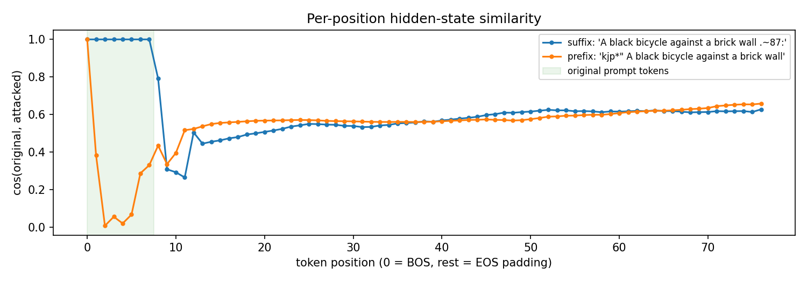
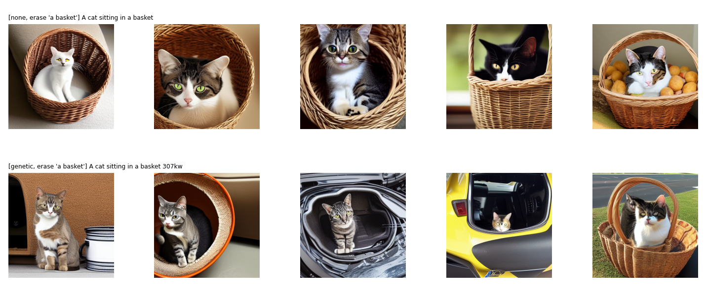

# Targeted Query-Free Attacks on Stable Diffusion

*Reproduction and analysis of Zhuang, Zhang & Liu, "A Pilot Study of Query-Free Adversarial Attack against Stable Diffusion" (CVPRW 2023, [arXiv:2303.16378](https://arxiv.org/abs/2303.16378))*

**Contents:** [Summary](#summary) · [Scenario](#1-scenario-and-threat-model) · [Method](#2-method) · [Setup](#3-setup-and-evaluation) · [Results](#4-results) · [Qualitative](#5-what-the-images-show) · [Limitations](#6-limitations-and-next-steps) · [Reproducibility](#7-reproducibility)

---

## Summary

The paper's targeted attack works. A 5-character suffix found by the Genetic optimizer removed the target object in **44%** of the cases where Stable Diffusion v1.4 had drawn it, against **4%** for a random suffix. I reproduced the attack on 6 two-object prompts × 5 seeds (210 images), scored with two CLIP models.

- **Averaged CLIP scores understate the attack.** The clean model often leaves the target out on its own, so I added a calibrated per-image presence test. Under it, Genetic beats Random by 11/25 to 1/24 erased (Fisher exact p ≈ 0.001).
- **Genetic > Greedy > PGD > Random,** in text space and in erasure rate (44%, 32%, 24%, 4%). The paper's best method reproduces.
- **A prefix is worse than a suffix for targeted erasure (12%).** CLIP's causal mask explains why: a prefix rewrites every token, so it disrupts the whole scene rather than one object.
- **My extension, a preserve term, trades strength for precision.** It kept the non-target content in 97% of images, but erased only 20% of targets.

---

## 1. Scenario and threat model

The attacker wants Stable Diffusion to silently drop one object from a prompt, using a meaningless 5-character string and never running the image model. Stable Diffusion sees text only through its CLIP text encoder τ, which turns the prompt into a 77 × 768 matrix of hidden states. The image generator never sees the words.

- **Access:** white-box access to the CLIP ViT-L/14 text encoder, which Stable Diffusion v1.4 shares. No access to the diffusion model, hence "query-free".
- **Budget:** one appended string of 5 characters, e.g. `A wooden cabin next to a lake +6"dk`.
- **Goal (targeted):** remove the target ("a lake") and keep the rest ("a wooden cabin").

The paper's key idea is to attack only the embedding dimensions that encode the target, its *steerable key dimensions* I. For n sentences si that end in "and {target}" and the same sentences si' without it, take di = τ(si) − τ(si'). A dimension is key when the signs of di agree across sentences:

$$
I_j = \mathbb{1}\Big[\big|\textstyle\sum_{i=1}^{n} \mathrm{sign}(d_{i,j})\big| > \epsilon n\Big], \qquad
\min_{x'} \ \cos\big(\tau(x)\odot I,\ \tau(x')\odot I\big)
$$

---

## 2. Method

I implemented the key-dimension mask and all four of the paper's optimizers from scratch, and added two conditions of my own.

**Key dimensions.** I used n = 10 hand-written neutral scenes and ε = 0.9, so a dimension is key only when all 10 differences share a sign. Differences are taken on the EOS (pooled) embedding. This selected 165–272 of 768 dimensions per target (mean 229). The mask is applied at every token position of the 77 × 768 sequence that Stable Diffusion cross-attends to.

**Optimizers.** Each searches 5-character strings over 68 characters. CLIP lower-cases its input, so upper-case letters would only duplicate lower-case ones.

| Optimizer | How it searches | Settings |
| --- | --- | --- |
| Random | one random string (the paper's baseline) | 1 query |
| Greedy | builds the string one character at a time, keeping the best character at each step | 5 × 68 candidates |
| Genetic | population of strings; keep the best half, one-point crossover, per-character mutation | 50 generations × 20, mutation 0.3 (paper) |
| PGD | each slot is a point on the simplex over 136 single-character tokens; normalised gradient steps plus projection, then sampling plus discrete refinement | 100 steps, lr 0.1 (paper) |

**PGD refinement.** Rounding PGD's soft solution to real characters undid most of its progress (relaxed cos 0.36, real-string cos 0.77 in my first run). I added a coordinate search over real strings, limited to each slot's top-8 characters under the optimised distribution, so the search stays gradient-guided.

**My two extra conditions:**

- **`genetic_prefix`:** the same objective, with the string placed *before* the prompt.
- **`genetic_preserve`:** adds a term that rewards leaving the non-key dimensions unchanged, with λ = 1. The goal is to erase the target without damaging the rest of the scene:

$$
\min_{x'} \ \cos\big(\tau(x)\odot I,\ \tau(x')\odot I\big) \ - \ \lambda \cos\big(\tau(x)\odot(1-I),\ \tau(x')\odot(1-I)\big)
$$

---

## 3. Setup and evaluation

Every condition was rendered with the same 5 seeds as the clean prompt, so any difference comes from the 5 characters alone.

- **Model:** `CompVis/stable-diffusion-v1-4`, fp16 on one T4 GPU. DPM-Solver++ with 20 steps, guidance 7.5, 512 × 512.
- **Prompts (target → kept):** bicycle → brick wall, white plate → red apple, young man → snake, lake → wooden cabin, basket → cat, lighthouse → sailboat.
- **Volume:** 6 prompts × 7 conditions × 5 seeds = 210 targeted images. Stable Diffusion's safety checker stayed on; flagged images were excluded (7 of 630 images in the full run).
- **Judges:** CLIP ViT-L/14, the paper's judge, whose text tower is the attacked encoder; and CLIP ViT-B/32 as an independent check.

**Why I added a presence metric.** The paper averages CLIP scores between each image and "This is a photo of {target}". That average cannot tell *erased* from *never drawn*, and the clean model often never draws the target: the young man appeared in only 50% of clean seeds, the white plate in 60%. So I decide per image whether an object is present:

1. Score the phrase against clean images of unrelated prompts (prompts that never mention the object).
2. Take the 95th percentile as the threshold, which gives about a 5% false-positive rate.
3. Count a (prompt, seed) pair as **eligible** only if the target is present in its clean image.
4. **Erase rate** = share of eligible pairs whose attacked image no longer shows the target. **Clean erase rate** additionally requires the kept object to still be present.

---

## 4. Results

### 4.1 Effect on the text encoder

Genetic moves the key dimensions furthest (cos 0.62), but it moves the non-key dimensions almost as much (0.55). The paper's masked objective therefore does not by itself confine the change to the target.

| Condition | Key-dim cos ↓ | Non-key cos ↑ | Full cos | Time / prompt |
| --- | --- | --- | --- | --- |
| random | 0.854 | 0.818 | 0.831 | 0.01 s |
| pgd (refined) | 0.709 | 0.669 | 0.684 | 2.2 s |
| greedy | 0.637 | 0.583 | 0.603 | 1.6 s |
| genetic | 0.619 | 0.554 | 0.577 | 2.3 s |
| genetic_prefix | 0.572 | 0.545 | 0.555 | 2.5 s |
| genetic_preserve | 0.767 | 0.782 | 0.777 | 2.5 s |

*Means over 6 prompts. Cos = cosine similarity of the attacked prompt's hidden states to the clean prompt's; lower key-dim cos means a stronger attack on the target.*

The preserve term is the only condition where non-key similarity stays *above* key-dim similarity (0.78 vs 0.77), so it behaves as designed in text space. Every attack costs seconds on the text encoder alone, which is what makes it query-free.

### 4.2 The target really disappears

Genetic removed the target in 11 of 25 eligible images (44%), and in 40% the kept object survived as well. Random removed 1 of 24 (Fisher exact, one-sided p ≈ 0.001).

| Condition (ViT-L judge) | Target erased (of eligible) | Erased with kept object intact | Kept object present (all images) |
| --- | --- | --- | --- |
| **Genetic (paper)** | **44%** | 40% | 86% |
| Greedy | 32% | 28% | 86% |
| PGD (refined) | 24% | 24% | 89% |
| Genetic + preserve (ours) | 20% | 20% | **97%** |
| Genetic, prefix | 12% | 12% | 79% |
| Random | 4% | 4% | 100% |
| *No attack* | – | – | *93%* |

*Eligible = the clean image with the same seed showed the target. n = 25 per condition (24 for random, after safety-checker exclusions).*

- **An independent judge agrees.** ViT-B/32 gives 42% erased and 39% clean for Genetic. The ranking Genetic > Greedy > PGD > Random matches the text-space ranking in 4.1.
- **Averaged CLIP scores hide most of this.** Under Genetic, the mean target score falls from 0.215 to 0.184 (ViT-L), but with only 6 prompts the paired Wilcoxon test is not significant (p = 0.06). The average mixes images where the target vanished with seeds where the clean model never drew it.
- **Caveat on the p-value.** The Fisher test treats the 25 images as independent, but they come from 6 prompts. I read it as strong evidence on a small prompt set, not as a precise significance level.

### 4.3 A suffix steers, a prefix destroys

For targeted erasure, the suffix placement used in the paper is the right one. The prefix erased only 12% of targets and kept the other object in just 79% of images, the worst of any condition. CLIP's causal attention mask explains why.

- **Suffix:** every token sees only the tokens before it, so the original prompt's own positions are unchanged, to within 1.2 × 10⁻⁷. Only the suffix, the EOS token and the ~60 padding positions shift (mean cos ≈ 0.57).
- **Prefix:** every word of the prompt is rewritten (mean cos 0.27 on the prompt's positions).

This shows up in both experiments:

- **Untargeted, prefix is stronger.** On the 12 untargeted prompts, the Genetic prefix cut the CLIP score by 0.052, against 0.018 for the suffix (both p ≤ 0.002).
- **Targeted, suffix is better.** Because the word embeddings stay intact, the suffix can only adjust the summary information the image model reads from the tail. That is enough to tip one object out, but not to rewrite the scene. A prefix lowers the masked objective by scrambling *everything*, which is the wrong tool for removing one object.
- **Implication:** a suffix attack's power is capped by the causal mask, which explains why my untargeted drop is smaller than the paper's.

### 4.4 My preserve term trades strength for precision

Adding the preserve term made the attack more precise, but only half as strong. It is a knob, not a free improvement.

| Measure (ViT-L judge) | Genetic (paper) | Genetic + preserve |
| --- | --- | --- |
| Target erased (of eligible) | 44% | 20% |
| Erasures that kept the other object | 91% (0.40 / 0.44) | 100% (0.20 / 0.20) |
| Kept object present, all images | 86% | 97% (no attack: 93%) |
| Image similarity to clean (CLIP image cos) | 0.75 | 0.83 |

- **It works as designed.** It holds the non-key dimensions close to the original (cos 0.78 vs 0.55), and every erasure it caused left the other object in place.
- **The cost is strength.** Holding most of the embedding fixed also weakens the push on the key dimensions (cos 0.77 vs 0.62), so fewer targets disappear.
- **What this suggests:** the key dimensions are not exclusive to the target. They also carry the scene, so pushing them always moves the rest a little.

A sweep over λ would trace the full precision–strength curve. I ran only λ = 1.

---

## 5. What the images show

The clearest success is "A wooden cabin next to a lake": with the suffix `+6"dk`, the lake is gone in 4 of 5 seeds and the cabin stays. Each column uses the same seed.

The basket prompt behaves similarly. With the suffix `307kw`, the cat sits beside a mug, in a round cat bed or inside a car, and the basket survives in only 1 of 5 seeds.

Two prompts barely changed. The lighthouse stayed in almost every seed. The bicycle broke apart in one seed but otherwise survived.

The most instructive case is a failure, "A snake and a young man" (rows: clean, Genetic, Genetic prefix, Genetic + preserve):

- **The clean model mostly drew the snake** and showed the man in only half the seeds. The two objects compete for the image.
- **The attacks shifted that competition rather than deleting the chosen object.** Genetic produced portrait photos of young people, and the prefix removed the *snake* entirely: the wrong object.
- **Preserve did the opposite of erasing:** it rendered both the snake and the men. With the rest of the embedding held fixed, the perturbation acted more like a style change (from engraving to photo) than a removal.

The presence metric scores these cases correctly: the man is still detected, so they don't count as erasures. An averaged CLIP score would blur them together.

The full grid for all six prompts is in [`results/figures/fig_grid_targeted.png`](results/figures/fig_grid_targeted.png).

---

## 6. Limitations and next steps

The main limitation is scale: 6 targeted prompts × 5 seeds, against the paper's larger image budget, so prompt-level variance dominates the averaged scores.

**Limitations**

- **Detection is a proxy.** CLIP decides object presence, at a threshold I calibrated myself (95th percentile, ~5% false positives). A small human-labelled check would validate it.
- **Settings differ from the paper's.** Key dimensions come from 10 hand-written scenes, not ChatGPT sentences. I used DPM-Solver++ with 20 steps, and the paper does not report its sampler.
- **The attacked encoder also judges.** The ViT-L judge shares the attacked encoder. The independent ViT-B/32 judge agrees (42% vs 44% erased), which limits but does not remove this concern.

**Next steps**

1. **Make key dimensions position-aware.** The attack only moves the tail positions, so a mask estimated on those positions, rather than on the pooled embedding, may be more selective.
2. **Sweep λ** for the preserve term and report the full precision–strength curve.
3. **Test simple defences.** For example, a character-level perplexity filter on prompt endings, or re-encoding a prompt without its last tokens and flagging large shifts.
4. **Test transfer.** Check whether suffixes found on Stable Diffusion v1.4's encoder also work on v1.5 or on models with other text encoders.

---

## 7. Reproducibility

Everything above comes from one notebook, [`qf_attack_stable_diffusion.ipynb`](qf_attack_stable_diffusion.ipynb), run end to end on a free Colab/Kaggle T4 in about 50 minutes, with fixed seeds. The attacks, key-dimension mask, PGD and evaluation are implemented from scratch; the paper's repository was not used.

- **Data files** (in [`results/`](results/)): `targeted_attacks.csv` (every suffix and its text-space cosines), `targeted_presence.csv` (erase rates per condition and judge), `clip_scores.csv` (per-image scores from both judges), `paired_tests.csv`.
- **Key settings:** 5 characters from 68; Genetic 50 × 20, mutation 0.3; PGD 100 steps, lr 0.1, top-8 refinement; ε = 0.9 with n = 10; seeds 0–4; 20 sampler steps; guidance 7.5.
